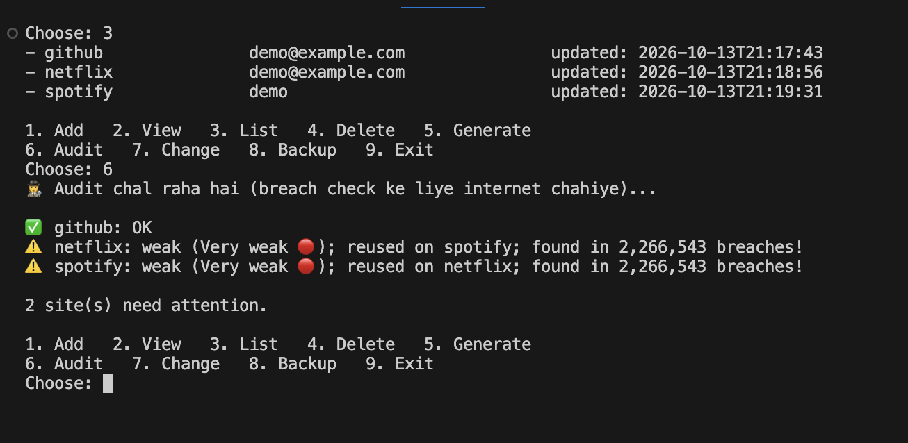

# 🔐 Zero-Knowledge Password Manager

A command-line password manager written in Python. You remember **one master password**, and it keeps all your other passwords **encrypted on your own computer**.

"Zero-knowledge" means the master password is never saved anywhere. Anyone who gets the vault file, without the master password, sees only scrambled data.



## Features

- 🔒 **AES-256-GCM encryption** with a key derived by **Argon2id** (the master password itself is never stored)
- 🎲 **Strong password generator**
- 🕵️ **Security audit** that finds weak, reused and leaked passwords (via [Have I Been Pwned](https://haveibeenpwned.com/Passwords), without ever sending your password)
- ⏱️ **Auto-lock** after 2 minutes of inactivity
- 📋 **Copy to clipboard** with auto-clear after 20 seconds (macOS)
- 💾 **Encrypted backups** and crash-safe saving

## Quick start

Requires **Python 3.10+**.

```bash
git clone https://github.com/<your-username>/zk-password-manager.git
cd zk-password-manager
python3 -m venv venv
source venv/bin/activate          # Windows: venv\Scripts\activate
pip install -r requirements.txt
python main.py
```

The first run asks you to create a master password. After that, it asks for it every time.

> ⚠️ **There is no "forgot password" option.** If you lose the master password, the vault cannot be opened by anyone, including you.

## How to use

Type a number or the word in the menu:

| Option | What it does |
|---|---|
| `1` add | Save a password for a website (leave password empty to auto-generate one) |
| `2` view | Show the username and copy the password |
| `3` list | List all saved websites |
| `4` delete | Remove a website |
| `5` generate | Create a strong random password |
| `6` audit | Check all passwords for being weak, reused or leaked |
| `7` change | Change the master password |
| `8` backup | Save an encrypted copy in the `backups/` folder |
| `9` exit | Lock the vault and quit |

## Where is my data?

Everything stays on your computer, in the project folder:

| File | What it is |
|---|---|
| `vault.json` | Your encrypted vault |
| `vault.json.bak` | Automatic copy of the previous version |
| `backups/` | Copies you made with option `8` |

All three are encrypted, so they're safe to copy to a USB drive or cloud storage.

- **Restore:** `cp vault.json.bak vault.json` (or copy a file from `backups/`)
- **Start over:** `rm vault.json vault.json.bak && rm -rf backups` (this deletes everything permanently)

## How it works

```
master password ──► Argon2id + salt ──► 256-bit key (kept only in memory)
                                              │
your passwords ──► AES-256-GCM encryption ◄───┘ ──► vault.json
```

- **Argon2id** is deliberately slow and memory-hungry, so guessing the master password is very expensive for an attacker.
- **AES-256-GCM** encrypts the vault and adds a seal: if even one byte of the file is changed, it refuses to open.
- **Breach check:** only the first 5 characters of the password's SHA-1 hash are sent to Have I Been Pwned. The match happens on your computer (k-anonymity).

### CIA triad

| | How |
|---|---|
| **Confidentiality** | Local encryption, master password never stored, auto-lock, clipboard auto-clear |
| **Integrity** | GCM seal detects any tampering |
| **Availability** | Crash-safe saving, automatic `.bak` copy, encrypted backups |

## Security notes

**Protects against:** a stolen laptop or vault file, offline password guessing, tampering with the file.

**Does not protect against:** malware or keyloggers already on your computer, someone using your computer while the vault is unlocked, or a weak master password.

This is a learning project and has not been professionally audited. For real-world use, prefer an audited manager such as Bitwarden.

## Run the tests

```bash
python -m unittest -v
```

## Project structure

```
crypto_utils.py   Argon2id key derivation + AES-GCM encryption
vault.py          Create, unlock, save and back up the vault
main.py           Menu, login and auto-lock
generator.py      Password generator
strength.py       Password strength check
breach.py         Have I Been Pwned check
clipboard.py      Clipboard copy with auto-clear
test_password_manager.py   Unit tests
```
